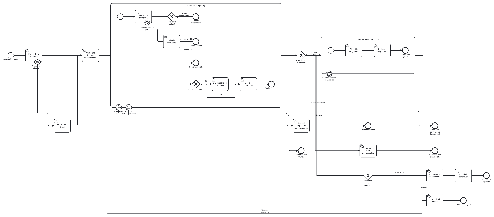

# Documento funzionale: contributi per eventi culturali

## 1. Scopo

Le associazioni iscritte all'albo comunale chiedono un contributo per organizzare eventi culturali aperti al
pubblico (regolamento comunale dei contributi, art. 8: istruttoria entro 60 giorni). L'applicazione sostituisce il
foglio Excel e le PEC sparse: ogni domanda diventa una pratica che segue da sola i suoi passi, con termini,
solleciti, email all'associazione e storico completo.

## 2. Chi è coinvolto

| Chi | Gruppo in Orditogram | Cosa fa |
|---|---|---|
| Operatore dell'Ufficio Cultura | `cultura` | inserisce la domanda, registra le integrazioni e le rinunce, protocolla a mano se serve |
| Istruttore dell'Ufficio Cultura | `cultura` | verifica la domanda e decide il contributo |
| Dirigente | `dirigenti` | dà il parere sopra i 5.000 euro, vede tutte le pratiche, riceve l'avviso del termine scaduto |
| Ragioneria | `ragioneria` | paga i contributi concessi e registra il mandato |
| Protocollo informatico | sistema collegato | protocolla la domanda e restituisce numero e data |
| Associazione | nessun accesso | riceve le comunicazioni via PEC |

## 3. Il flusso in breve

1. **Domanda.** L'operatore inserisce la domanda arrivata allo sportello o via PEC: sceglie l'associazione
   dall'albo, descrive l'evento, compila il piano delle spese, indica l'importo richiesto e la PEC, allega la
   domanda firmata e il bilancio preventivo.
2. **Protocollo.** L'applicazione protocolla la domanda nel protocollo informatico. Se il protocollo non risponde,
   l'operatore trova l'attività **Protocolla a mano** e scrive numero e data.
3. **Conferma.** L'associazione riceve una PEC con il numero di protocollo.
4. **Istruttoria (entro 60 giorni).** L'istruttore **verifica la domanda**: ammissibile, non ammissibile o servono
   integrazioni. Se la domanda chiede più di 5.000 euro, il dirigente **dà il parere** prima della decisione.
   L'istruttore poi **decide il contributo**: concesso (con l'importo) o negato, con la motivazione.
5. **Integrazioni.** Se mancano documenti, l'associazione riceve una PEC con l'elenco. Quando le integrazioni
   arrivano l'operatore le **registra** (cosa è arrivato, con i documenti) e l'istruttoria riparte da capo (anche il termine di 60 giorni). Senza risposta
   in 15 giorni la domanda è archiviata.
6. **Esito.** L'associazione riceve la PEC con l'esito: non ammissibile, contributo negato o concesso. Se è
   concesso la Ragioneria **liquida il contributo** e registra il mandato di pagamento.

## 4. Regole

- **Termine dell'istruttoria**: 60 giorni dall'inizio dell'istruttoria (subito dopo il protocollo). Se l'ultimo
  giorno è festivo, il termine slitta al primo giorno lavorativo. Allo scadere la pratica si chiude come
  **Termine decorso** e i dirigenti ricevono una notifica: la domanda si decide fuori dal sistema.
- **Sollecito**: se la verifica non è fatta, l'Ufficio Cultura riceve una notifica dopo 10 e dopo 20 giorni.
- **Integrazioni**: 15 giorni per rispondere, con la stessa regola sui festivi.
- **Parere del dirigente**: obbligatorio sopra i 5.000 euro richiesti (strettamente maggiore), non vincolante:
  l'istruttore lo vede quando decide.
- **Importi**: contributo richiesto da 100 a 20.000 euro; contributo concesso fino a 20.000 euro.
- **Rinuncia**: in qualsiasi momento dell'istruttoria l'operatore registra la rinuncia dell'associazione (e allega
  la lettera); la pratica si archivia.
- **Motivazioni**: obbligatorie per la non ammissibilità, per le integrazioni (cosa manca) e per ogni decisione;
  finiscono nella PEC all'associazione.

## 5. Dati raccolti

| Momento | Dati |
|---|---|
| Domanda | associazione (dall'albo), PEC, titolo, data, luogo e descrizione dell'evento, patrocinio e uso del logo, piano delle spese, contributo richiesto, allegati |
| Protocollo | numero e data di protocollo |
| Verifica | esito, cosa manca o perché non è ammissibile, integrazioni ricevute |
| Parere | parere e note del dirigente |
| Decisione | esito, contributo concesso, motivazione |
| Liquidazione | numero del mandato, data del pagamento |

Dati personali: il legale rappresentante dell'associazione (nell'albo) e i dati di contatto. Nessun dato
particolare (art. 9 GDPR).

L'**albo delle associazioni** è un archivio dell'applicazione: denominazione, codice fiscale (unico), numero di
iscrizione, settore, sede, PEC, legale rappresentante. Lo tiene l'Ufficio Cultura.

## 6. Comunicazioni

| Quando | A chi | Cosa |
|---|---|---|
| Dopo il protocollo | PEC dell'associazione | conferma con numero e data di protocollo |
| Servono integrazioni | PEC dell'associazione | elenco di ciò che manca, termine di 15 giorni |
| Non ammissibile | PEC dell'associazione | motivo e possibilità di ricorso |
| Contributo concesso | PEC dell'associazione | importo e motivazione, con i documenti della pratica |
| Contributo negato | PEC dell'associazione | motivazione e possibilità di ricorso |
| 10 e 20 giorni senza verifica | Ufficio Cultura (notifica) | sollecito |
| Termine di 60 giorni scaduto | dirigenti (notifica) | avviso |

I testi completi sono nella [scheda tecnica](04-scheda-tecnica.md).

## 7. Integrazioni

- **Protocollo informatico**: chiamata alle sue API alla registrazione della domanda; restituisce numero e data.
  Se non risponde entro 20 secondi, la pratica passa a **Protocolla a mano**.

## 8. Chi vede cosa

- Avviano le domande solo gli utenti dell'Ufficio Cultura.
- Vedono tutte le pratiche l'Ufficio Cultura e i dirigenti (i dirigenti possono anche esportarle).
- La Ragioneria vede le pratiche che deve liquidare.
- L'albo lo modifica ed esporta l'Ufficio Cultura; i dirigenti lo consultano.

## 9. Scelte fatte e punti da confermare

- Dopo le integrazioni il termine di 60 giorni riparte da capo. *Da confermare.*
- Il parere contrario del dirigente non blocca la concessione. *Da confermare.*
- La PEC per le comunicazioni si chiede in ogni domanda, anche se l'albo ha la PEC dell'associazione.
- Allo scadere dei 60 giorni non si scrive all'associazione (la specifica non lo prevede).

## 10. Glossario

| Termine | Significato |
|---|---|
| Pratica | una domanda, dall'inserimento alla chiusura |
| Attività | un passo che fa una persona; compare nella scrivania del suo gruppo |
| Scrivania | elenco delle attività da fare |
| Storico | tutto ciò che è successo nella pratica, chi e quando |
| Albo | elenco delle associazioni iscritte |
