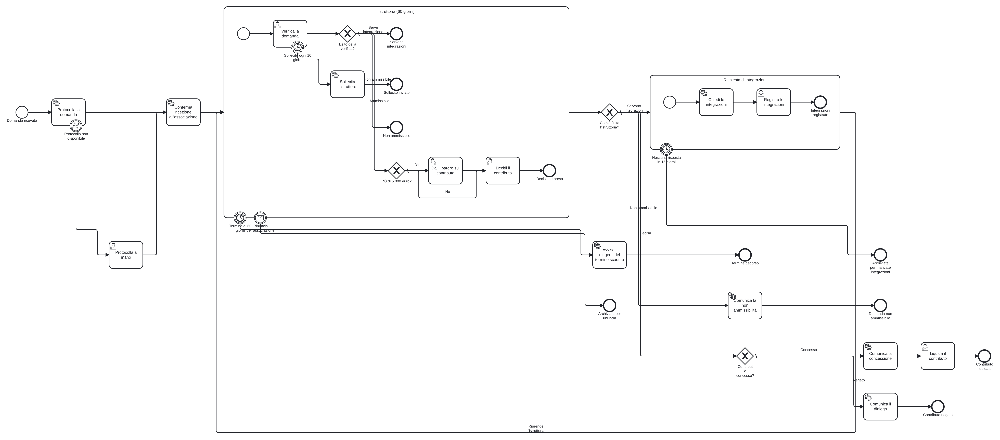

# Scheda tecnica: Contributi per eventi culturali

Generata dagli artefatti della soluzione con `documenta.py`: non modificarla a mano, rigenerala.

Domanda di contributo di un'associazione dell'albo comunale per un evento culturale: protocollo, istruttoria entro 60 giorni con integrazioni e parere del dirigente sopra i 5.000 euro, comunicazione dell'esito e liquidazione.

| | |
|---|---|
| Identificativo del processo | `contributiEventi` |
| Chi può avviare (BPMN) | cultura |
| Gruppi che lavorano le attività | cultura, dirigenti, ragioneria |
| Form | `ce-domanda`, `ce-protocollo`, `ce-verifica`, `ce-parere`, `ce-decisione`, `ce-integrazioni`, `ce-liquidazione` |
| Anagrafiche | `associazioni` |



## Passi del processo

| Passo | Tipo | Chi | Form | Note |
|---|---|---|---|---|
| Domanda ricevuta | Avvio | cultura | `ce-domanda` |  |
| Protocolla la domanda | Automatica | Orditogram |  | chiama un servizio esterno; se non riesce ("Protocollo non disponibile") → Protocolla a mano |
| Protocolla a mano | Attività | gruppo cultura | `ce-protocollo` |  |
| Conferma ricezione all'associazione | Automatica | Orditogram |  | invia un'email |
| Istruttoria (60 giorni) | Sottoprocesso |  |  | scadenza "Termine di 60 giorni": 60 giorni (se scade in un giorno festivo, slitta al primo lavorativo) → Avvisa i dirigenti del termine scaduto; se arriva il messaggio `rinunciaAssociazione` → Archiviata per rinuncia |
| Verifica la domanda (nel sottoprocesso) | Attività | gruppo cultura | `ce-verifica` | sollecito "Sollecito ogni 10 giorni": ogni 10 giorni, al massimo 2 volte → Sollecita l'istruttore |
| Sollecita l'istruttore (nel sottoprocesso) | Automatica | Orditogram |  | invia una notifica |
| Sollecito inviato (nel sottoprocesso) | Fine |  |  |  |
| Servono integrazioni (nel sottoprocesso) | Fine |  |  |  |
| Non ammissibile (nel sottoprocesso) | Fine |  |  |  |
| Dai il parere sul contributo (nel sottoprocesso) | Attività | gruppo dirigenti | `ce-parere` |  |
| Decidi il contributo (nel sottoprocesso) | Attività | gruppo cultura | `ce-decisione` |  |
| Decisione presa (nel sottoprocesso) | Fine |  |  |  |
| Archiviata per rinuncia | Fine |  |  |  |
| Avvisa i dirigenti del termine scaduto | Automatica | Orditogram |  | invia una notifica |
| Termine decorso | Fine |  |  |  |
| Richiesta di integrazioni | Sottoprocesso |  |  | scadenza "Nessuna risposta in 15 giorni": 15 giorni (se scade in un giorno festivo, slitta al primo lavorativo) → Archiviata per mancate integrazioni |
| Chiedi le integrazioni (nel sottoprocesso) | Automatica | Orditogram |  | invia un'email |
| Registra le integrazioni (nel sottoprocesso) | Attività | gruppo cultura | `ce-integrazioni` |  |
| Integrazioni registrate (nel sottoprocesso) | Fine |  |  |  |
| Archiviata per mancate integrazioni | Fine |  |  |  |
| Comunica la non ammissibilità | Automatica | Orditogram |  | invia un'email |
| Domanda non ammissibile | Fine |  |  |  |
| Comunica la concessione | Automatica | Orditogram |  | invia un'email |
| Liquida il contributo | Attività | gruppo ragioneria | `ce-liquidazione` |  |
| Contributo liquidato | Fine |  |  |  |
| Comunica il diniego | Automatica | Orditogram |  | invia un'email |
| Contributo negato | Fine |  |  |  |

## Decisioni

- **Esito della verifica?**
  - `${esitoVerifica == 'Serve integrazione'}` → Servono integrazioni ("Serve integrazione")
  - `${esitoVerifica == 'Non ammissibile'}` → Non ammissibile ("Non ammissibile")
  - altrimenti → Più di 5.000 euro? ("Ammissibile")
- **Più di 5.000 euro?**
  - `${importoRichiesto > 5000.0}` → Dai il parere sul contributo ("Sì")
  - altrimenti → Decidi il contributo ("No")
- **Com'è finita l'istruttoria?**
  - `${esitoVerifica == 'Serve integrazione'}` → Richiesta di integrazioni ("Servono integrazioni")
  - `${esitoVerifica == 'Non ammissibile'}` → Comunica la non ammissibilità ("Non ammissibile")
  - altrimenti → Contributo concesso? ("Decisa")
- **Contributo concesso?**
  - `${esito == 'Concesso'}` → Comunica la concessione ("Concesso")
  - altrimenti → Comunica il diniego ("Negato")

## Attività automatiche

### Protocolla la domanda

- Chiamata **POST** a `http://localhost:8080/api/demo/protocollo`
- Credenziale: `protocollo-demo` (configurata sul server)
- Dati salvati dalla risposta: `numeroProtocollo = numero`, `dataProtocollo = data`
- Attesa massima: 20 secondi
- Se non riesce: Segui la strada di errore
- Corpo della richiesta:

```json
{
  "oggetto": "Domanda di contributo: ${titoloEvento}",
  "mittente": "${associazione_titolo}",
  "verso": "entrata"
}
```

### Conferma ricezione all'associazione

- A: l'indirizzo nel campo `pec`
- Oggetto: Domanda di contributo per "${titoloEvento}": protocollo ${numeroProtocollo}
- Allegati: Nessuno
- Testo:

```
Gentile associazione,

la domanda di contributo per l'evento "${titoloEvento}" è stata registrata con il protocollo n. ${numeroProtocollo} del ${dataProtocollo}.

L'istruttoria si conclude entro 60 giorni (regolamento comunale, art. 8).

Ufficio Cultura del Comune di Valfiorita
```

### Sollecita l'istruttore

- A: il gruppo cultura
- Titolo: Da verificare: contributo per ${titoloEvento}
- Messaggio: La domanda di ${associazione_titolo} (protocollo ${numeroProtocollo}) aspetta la verifica. L'istruttoria si chiude entro 60 giorni dal protocollo.

### Avvisa i dirigenti del termine scaduto

- A: il gruppo dirigenti
- Titolo: Termine scaduto: contributo per ${titoloEvento}
- Messaggio: Sono passati 60 giorni senza decisione sulla domanda di ${associazione_titolo} (protocollo ${numeroProtocollo}). La pratica è chiusa: la domanda va decisa fuori dal sistema.

### Chiedi le integrazioni

- A: l'indirizzo nel campo `pec`
- Oggetto: Domanda di contributo ${numeroProtocollo}: servono integrazioni
- Allegati: Nessuno
- Testo:

```
Gentile associazione,

per completare l'istruttoria della domanda per l'evento "${titoloEvento}" ci servono:
${noteVerifica}

Le chiediamo di inviarle via PEC entro 15 giorni: senza risposta la domanda sarà archiviata.

Ufficio Cultura del Comune di Valfiorita
```

### Comunica la non ammissibilità

- A: l'indirizzo nel campo `pec`
- Oggetto: Domanda di contributo ${numeroProtocollo}: non ammissibile
- Allegati: Nessuno
- Testo:

```
Gentile associazione,

la domanda di contributo per l'evento "${titoloEvento}" non è ammissibile per questo motivo:
${noteVerifica}

Contro questa decisione può presentare ricorso al TAR entro 60 giorni.

Ufficio Cultura del Comune di Valfiorita
```

### Comunica la concessione

- A: l'indirizzo nel campo `pec`
- Oggetto: Domanda di contributo ${numeroProtocollo}: contributo concesso
- Allegati: Tutti i documenti della pratica
- Testo:

```
Gentile associazione,

per l'evento "${titoloEvento}" le è stato concesso un contributo di ${importoConcesso} euro.
${motivazioneDecisione}

La Ragioneria provvederà al pagamento.

Ufficio Cultura del Comune di Valfiorita
```

### Comunica il diniego

- A: l'indirizzo nel campo `pec`
- Oggetto: Domanda di contributo ${numeroProtocollo}: contributo non concesso
- Allegati: Nessuno
- Testo:

```
Gentile associazione,

per l'evento "${titoloEvento}" il contributo non è stato concesso:
${motivazioneDecisione}

Contro questa decisione può presentare ricorso al TAR entro 60 giorni.

Ufficio Cultura del Comune di Valfiorita
```

## Messaggi in arrivo da altri sistemi

| Messaggio | Dove | Dati portati | Indirizzo |
|---|---|---|---|
| `rinunciaAssociazione` | sul bordo di "Istruttoria (60 giorni)" | - | `POST /api/messaggi/rinunciaAssociazione` (sistemi, chiave API) o `POST /api/pratiche/{id}/messaggi/rinunciaAssociazione` (operatore) |

## Form

### Domanda di contributo per un evento culturale (`ce-domanda`)

Inserisci la domanda dell'associazione così come è arrivata. Allega la domanda firmata e il bilancio preventivo.

_usato in: Domanda ricevuta; si caricano documenti (almeno uno obbligatorio)_

| Campo | Nome | Tipo | Obbl. | Regole e note |
|---|---|---|---|---|
| **Associazione** | | sezione | |  |
| Associazione | `associazione` | Anagrafica | sì | scheda di `associazioni`; Deve essere iscritta all'albo. Se manca, chiedi all'Ufficio Cultura di iscriverla. |
| PEC per le comunicazioni | `pec` | Testo | sì | formato email |
| **Evento** | | sezione | |  |
| Titolo dell'evento | `titoloEvento` | Testo | sì | titolo della pratica/scheda; al massimo 150 caratteri |
| Data dell'evento | `dataEvento` | Data | sì | minimo oggi |
| Luogo | `luogo` | Testo | sì |  |
| Descrizione dell'evento | `descrizione` | Testo lungo | sì | almeno 30 caratteri |
| Chiede anche il patrocinio del Comune | `patrocinio` | Sì/No |  |  |
| Userà il logo del Comune | `usoLogo` | Scelta | sì | scelte: Sì, No; solo se `patrocinio` è "true" |
| **Spese e contributo** | | sezione | |  |
| Piano delle spese | `spese` | Tabella | sì | colonne: Voce di spesa (Testo), Importo (€) (Numero); righe da 1 a 30 |
| Contributo richiesto (€) | `importoRichiesto` | Numero | sì | minimo 100; massimo 20000 |

### Protocolla a mano (`ce-protocollo`)

Il protocollo informatico non ha risposto. Protocolla la domanda dal programma del protocollo e scrivi qui numero e data.

_usato in: Protocolla a mano; documenti in sola lettura_

| Campo | Nome | Tipo | Obbl. | Regole e note |
|---|---|---|---|---|
| Evento | `titoloEvento` | Testo |  | sola lettura |
| Associazione | `associazione_titolo` | Testo |  | sola lettura |
| Numero di protocollo | `numeroProtocollo` | Testo | sì |  |
| Data di protocollo | `dataProtocollo` | Data | sì | massimo oggi |

### Verifica la domanda (`ce-verifica`)

Controlla che l'associazione e l'evento rispettino il regolamento e che la domanda sia completa.

_usato in: Verifica la domanda; documenti modificabili_

| Campo | Nome | Tipo | Obbl. | Regole e note |
|---|---|---|---|---|
| **Domanda** | | sezione | |  |
| Associazione | `associazione_titolo` | Testo |  | sola lettura |
| Protocollo | `numeroProtocollo` | Testo |  | sola lettura |
| Evento | `titoloEvento` | Testo |  | sola lettura |
| Data | `dataEvento` | Data |  | sola lettura |
| Descrizione | `descrizione` | Testo lungo |  | sola lettura |
| Contributo richiesto (€) | `importoRichiesto` | Numero |  | sola lettura |
| Integrazioni ricevute | `noteIntegrazioni` | Testo lungo |  | sola lettura |
| **Esito della verifica** | | sezione | |  |
| Esito | `esitoVerifica` | Scelta | sì | scelte: Ammissibile, Serve integrazione, Non ammissibile |
| Cosa manca o perché non è ammissibile | `noteVerifica` | Testo lungo | sì | solo se `esitoVerifica` è "Serve integrazione" o "Non ammissibile"; Questo testo va nell'email all'associazione. |

### Parere del dirigente (`ce-parere`)

Il contributo richiesto supera i 5.000 euro: serve il tuo parere prima della decisione.

_usato in: Dai il parere sul contributo; documenti in sola lettura_

| Campo | Nome | Tipo | Obbl. | Regole e note |
|---|---|---|---|---|
| Associazione | `associazione_titolo` | Testo |  | sola lettura |
| Evento | `titoloEvento` | Testo |  | sola lettura |
| Contributo richiesto (€) | `importoRichiesto` | Numero |  | sola lettura |
| Piano delle spese | `spese` | Tabella |  | sola lettura; colonne: Voce di spesa (Testo), Importo (€) (Numero) |
| Parere | `parere` | Scelta | sì | scelte: Favorevole, Contrario |
| Note per l'istruttore | `noteParere` | Testo lungo | sì | solo se `parere` è "Contrario" |

### Decidi il contributo (`ce-decisione`)

_usato in: Decidi il contributo; documenti modificabili_

| Campo | Nome | Tipo | Obbl. | Regole e note |
|---|---|---|---|---|
| Associazione | `associazione_titolo` | Testo |  | sola lettura |
| Evento | `titoloEvento` | Testo |  | sola lettura |
| Contributo richiesto (€) | `importoRichiesto` | Numero |  | sola lettura |
| Parere del dirigente | `parere` | Testo |  | sola lettura |
| Note del dirigente | `noteParere` | Testo lungo |  | sola lettura |
| Decisione | `esito` | Scelta | sì | scelte: Concesso, Negato |
| Contributo concesso (€) | `importoConcesso` | Numero | sì | minimo 1; massimo 20000; solo se `esito` è "Concesso" |
| Motivazione | `motivazioneDecisione` | Testo lungo | sì | Va nell'email all'associazione. |

### Registra le integrazioni (`ce-integrazioni`)

Quando l'associazione manda quanto richiesto, descrivi cosa è arrivato e allega i documenti. L'istruttoria riparte.

_usato in: Registra le integrazioni; si caricano documenti_

| Campo | Nome | Tipo | Obbl. | Regole e note |
|---|---|---|---|---|
| Evento | `titoloEvento` | Testo |  | sola lettura |
| Protocollo | `numeroProtocollo` | Testo |  | sola lettura |
| Cosa era stato chiesto | `noteVerifica` | Testo lungo |  | sola lettura |
| Cosa è arrivato | `noteIntegrazioni` | Testo lungo | sì |  |

### Liquida il contributo (`ce-liquidazione`)

_usato in: Liquida il contributo; documenti in sola lettura_

| Campo | Nome | Tipo | Obbl. | Regole e note |
|---|---|---|---|---|
| Associazione | `associazione_titolo` | Testo |  | sola lettura |
| Evento | `titoloEvento` | Testo |  | sola lettura |
| Contributo concesso (€) | `importoConcesso` | Numero |  | sola lettura |
| Numero del mandato di pagamento | `numeroMandato` | Testo | sì |  |
| Data del pagamento | `dataPagamento` | Data | sì | massimo oggi |

## Anagrafiche

### Albo delle associazioni (`associazioni`)

Associazioni iscritte all'albo comunale: possono chiedere contributi e patrocini.

| Campo | Nome | Tipo | Obbl. | Regole e note |
|---|---|---|---|---|
| **Associazione** | | sezione | |  |
| Denominazione | `denominazione` | Testo | sì | titolo della pratica/scheda; al massimo 200 caratteri; ricercabile |
| Codice fiscale | `codiceFiscale` | Testo | sì | formato codice fiscale; chiave (unica) |
| Numero di iscrizione all'albo | `numeroIscrizione` | Testo | sì | ricercabile |
| Settore | `settore` | Scelta | sì | scelte: Musica, Teatro, Arti visive, Letteratura, Tradizioni popolari, Altro |
| **Recapiti** | | sezione | |  |
| Sede | `sede` | Testo |  |  |
| PEC | `pec` | Testo |  | formato email |
| Legale rappresentante | `legaleRappresentante` | Testo | sì |  |

### Chi usa le anagrafiche

| Anagrafica | Azione | Chi |
|---|---|---|
| `associazioni` | crea e modifica le schede | gruppo cultura |
| `associazioni` | esporta in CSV | gruppo cultura |
| `associazioni` | vede le schede | gruppo dirigenti |

## Chi avvia, vede ed esporta le pratiche

| Azione | Chi | Ambito |
|---|---|---|
| AVVIA | gruppo cultura | tutte le pratiche |
| VEDE | gruppo cultura | tutte le pratiche |
| VEDE | gruppo dirigenti | tutte le pratiche |
| ESPORTA | gruppo dirigenti | tutte le pratiche |

## Da predisporre nell'installazione del cliente

- Gruppi (locali o dal provider di identità): `cultura`, `dirigenti`, `ragioneria`
- Credenziali dei servizi esterni (`app.credenziali` o variabili d'ambiente): `protocollo-demo`
- Server email (`spring.mail.host`): senza, le email restano "non inviate" e la pratica prosegue
- Chiave API con permesso `messaggi:invia` per ogni sistema che invia messaggi
- Calendario delle festività aggiornato (Amministrazione → Calendario) se il processo usa giorni lavorativi o proroghe
