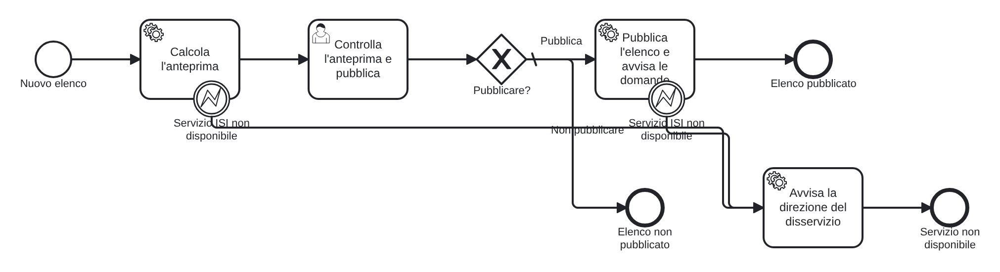

# Scheda tecnica: Bando ISI: elenchi cronologici

Generata dagli artefatti della soluzione con `documenta.py`: non modificarla a mano, rigenerala.

La direzione calcola un elenco del Bando ISI (NCD, provvisorio o definitivo con la redistribuzione), ne controlla l'anteprima e lo pubblica: il servizio ISI aggiorna lo stato delle domande e avvisa ogni pratica con il suo esito.

| | |
|---|---|
| Identificativo del processo | `isiElenchi` |
| Chi può avviare (BPMN) | tutti gli utenti |
| Gruppi che lavorano le attività | direzione-isi |
| Form | `isie-avvio`, `isie-pubblica` |
| Anagrafiche | nessuna |



## Passi del processo

| Passo | Tipo | Chi | Form | Note |
|---|---|---|---|---|
| Nuovo elenco | Avvio | tutti | `isie-avvio` |  |
| Calcola l'anteprima | Automatica | Orditogram |  | chiama un servizio esterno; se non riesce ("Servizio ISI non disponibile") → Avvisa la direzione del disservizio |
| Controlla l'anteprima e pubblica | Attività | gruppo direzione-isi | `isie-pubblica` |  |
| Pubblica l'elenco e avvisa le domande | Automatica | Orditogram |  | chiama un servizio esterno; se non riesce ("Servizio ISI non disponibile") → Avvisa la direzione del disservizio |
| Avvisa la direzione del disservizio | Automatica | Orditogram |  | invia una notifica |
| Elenco pubblicato | Fine |  |  |  |
| Elenco non pubblicato | Fine |  |  |  |
| Servizio non disponibile | Fine |  |  |  |

## Decisioni

- **Pubblicare?**
  - `${decisioneElenco == 'Pubblica'}` → Pubblica l'elenco e avvisa le domande ("Pubblica")
  - altrimenti → Elenco non pubblicato ("Non pubblicare")

## Attività automatiche

### Calcola l'anteprima

- Chiamata **POST** a `http://localhost:8095/elenchi/anteprima`
- Credenziale: `servizio-isi` (configurata sul server)
- Dati salvati dalla risposta: `righeElenco = righeElenco`, `riepilogoElenco = riepilogoElenco`
- Attesa massima: 60 secondi
- Se non riesce: Segui la strada di errore
- Corpo della richiesta:

```json
{"tipoElenco": "${tipoElenco}"}
```

### Pubblica l'elenco e avvisa le domande

- Chiamata **POST** a `http://localhost:8095/elenchi/pubblica`
- Credenziale: `servizio-isi` (configurata sul server)
- Dati salvati dalla risposta: `praticheAvvisate = praticheAvvisate`, `termineDocumenti = termineDocumenti`, `riepilogoElenco = riepilogoElenco`
- Attesa massima: 60 secondi
- Se non riesce: Segui la strada di errore
- Corpo della richiesta:

```json
{"tipoElenco": "${tipoElenco}"}
```

### Avvisa la direzione del disservizio

- A: il gruppo direzione-isi
- Titolo: Elenco ${tipoElenco} non calcolato
- Messaggio: Il servizio ISI non ha risposto: l'elenco ${tipoElenco} non è stato calcolato né pubblicato. Riprova con un nuovo elenco.

## Form

### Calcola un elenco del Bando ISI (`isie-avvio`)

Il servizio ISI calcola l'elenco su tutte le domande registrate; prima della pubblicazione vedi l'anteprima.

_usato in: Nuovo elenco_

| Campo | Nome | Tipo | Obbl. | Regole e note |
|---|---|---|---|---|
| Elenco | `tipoElenco` | Scelta | sì | titolo della pratica/scheda; scelte: NCD, PROVVISORIO, DEFINITIVO; NCD alla chiusura della registrazione; PROVVISORIO dopo lo sportello; DEFINITIVO dopo il caricamento dei documenti (redistribuzione). |

### Controlla l'anteprima e pubblica (`isie-pubblica`)

La pubblicazione è definitiva: cambia lo stato delle domande e avvisa ciascuna pratica con il suo esito.

_usato in: Controlla l'anteprima e pubblica_

| Campo | Nome | Tipo | Obbl. | Regole e note |
|---|---|---|---|---|
| Elenco | `tipoElenco` | Testo |  | sola lettura |
| Domande nell'elenco | `righeElenco` | Testo |  | sola lettura |
| Anteprima (Regione · Asse · posizione · domanda · importo · esito) | `riepilogoElenco` | Testo lungo |  | sola lettura |
| Cosa fai | `decisioneElenco` | Scelta | sì | scelte: Pubblica, Non pubblicare |
| Ho controllato l'anteprima: pubblica l'elenco | `confermaPubblicazione` | Sì/No | sì | solo se `decisioneElenco` è "Pubblica" |

## Chi avvia, vede ed esporta le pratiche

| Azione | Chi | Ambito |
|---|---|---|
| AVVIA | gruppo direzione-isi | tutte le pratiche |
| VEDE | gruppo direzione-isi | tutte le pratiche |

## Da predisporre nell'installazione del cliente

- Gruppi (locali o dal provider di identità): `direzione-isi`
- Credenziali dei servizi esterni (`app.credenziali` o variabili d'ambiente): `servizio-isi`
- Calendario delle festività aggiornato (Amministrazione → Calendario) se il processo usa giorni lavorativi o proroghe
